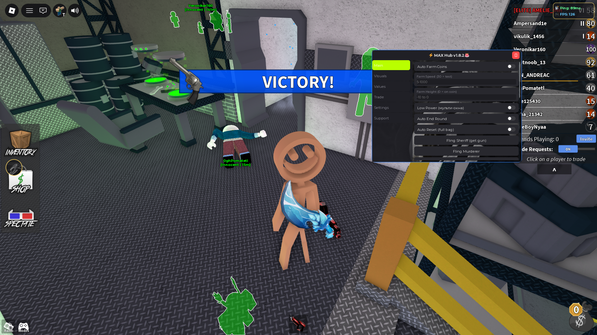
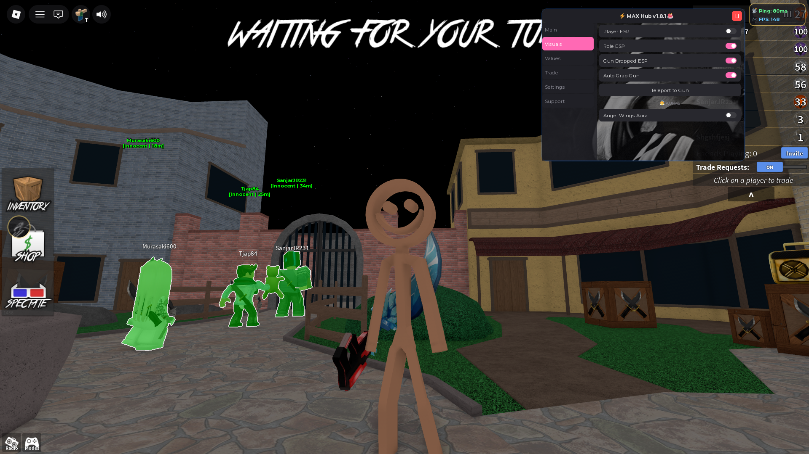
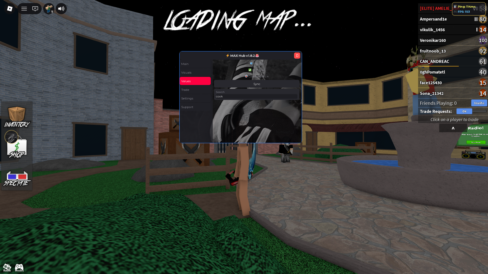
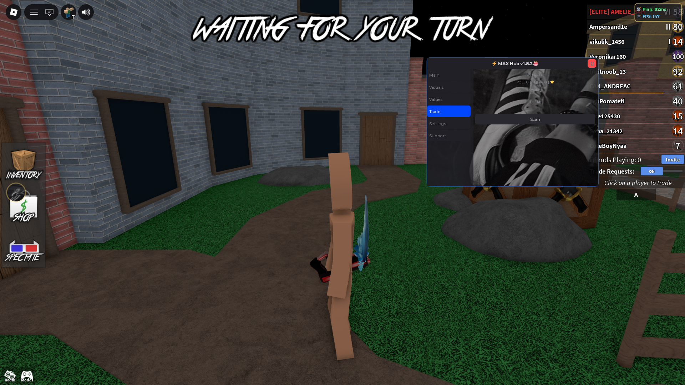
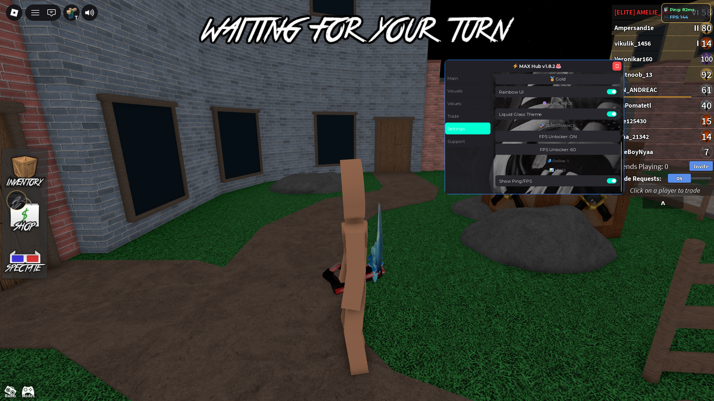

# ⚡ MAX Hub (v1.8.2 GOLD)

**MAX Hub** is an advanced and optimized script hub for **Murder Mystery 2**. 
It features everything from a smart auto-farm with physics bypass to a trade calculator and visual effects.

---

## 📸 Screenshots

---

## 🚀 Installation & Usage

Copy this line and paste it into your executor (Solara, Delta, Xeno, etc.):

**loadstring(game:HttpGet("https://raw.githubusercontent.com/sega1games12-alt/MAX-Hub/main/hub.lua"))()**

*Make sure the game is fully loaded before executing.*

---

## ✨ Features

### 💰 Auto Farm
*   **Smart Flight:** Physics bypass (noclip + velocity stabilization) — you won't fall through the map.
*   **Auto End Round:** When your bag is full, the hub will automatically kill everyone (if Murderer), shoot the Murderer (if Sheriff), or fling them (if Innocent).
*   **Auto Reset:** Automatically resets your character after a full bag.

### ⚔️ Combat
*   **Kill Aura** (Murderer)
*   **Auto Shot** (Sheriff)
*   **Auto Grab Gun**
*   **Fling Murderer / Sheriff** (high-velocity fling)

### 🎨 Visuals & UI
*   Player ESP, Role ESP, Gun Dropped ESP
*   Fullbright
*   Angel Wings Aura (Beam effect)
*   Liquid Glass Mode (transparency, pulsation, hover effects)
*   6 UI themes (Blue, Red, Green, Purple, Pink, Gold)

### 🏃 Movement
*   Fly, NoClip, Speed, Jump
*   Infinite Jumps
*   Anti-Fling (protection against being flung)

### 🛠️ Utility
*   **Values/Trade Calculator** (270+ skins)
*   Teleport to Lobby / Map / Gun
*   Server Hop
*   Show Ping/FPS + FPS Unlocker
*   **Low Power Mode** (for multi-window setups)

---

## 📝 Changelog

### v1.8.2 (Current)
*   🛡️ **Architecture:** Implemented RUN.alive() system — prevents GUI duplication on re-execution.
*   🏃 **Auto Farm v9:** Complete removal of Tween in favor of direct position interpolation (virtPos). Character now flies smoothly without falling into the void.
*   🔄 **Auto End Round v2:** Reliable full-bag detection via CashBag and server remotes.
*   ⚡ **Server Hop:** Rewritten using Cloudflare API (faster and more stable).
*   🎨 **UI:** Added online counter and Support tab.

### v1.7.0
*   🥇 Added Gold Edition.
*   🎯 Added Ping/FPS counter.
*   🎯 Added floating hub icon (minimize/maximize).
*   👼 Added Angel Aura (Beam wings with color sync).

### v1.6.5
*   ✨ Added Liquid Glass Mode (glass + pulsation).
*   💱 Improved Trade Calculator.
*   🌫️ Added Fullbright.

---

## ⚠️ Disclaimer

> Using scripts violates Roblox Terms of Service and may result in account bans. Use at your own risk, preferably on an alt account. The author is not responsible for any bans or damage.

---

## 💬 Feedback

Found a bug? Open an **Issue** in this repository.
Discord: `maks_seks_bobma` (replies may take a while).

---
*Made with ❤️ by [sega1games12-alt](https://github.com/sega1games12-alt)*
